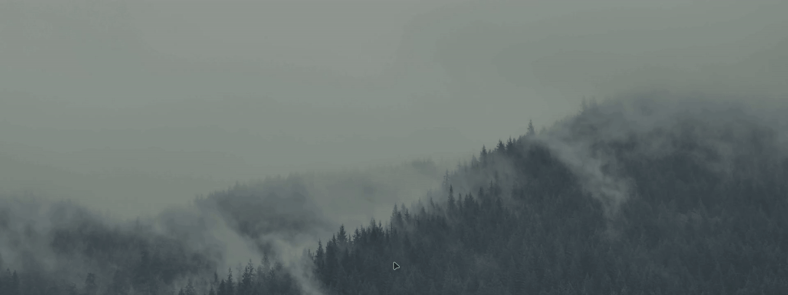
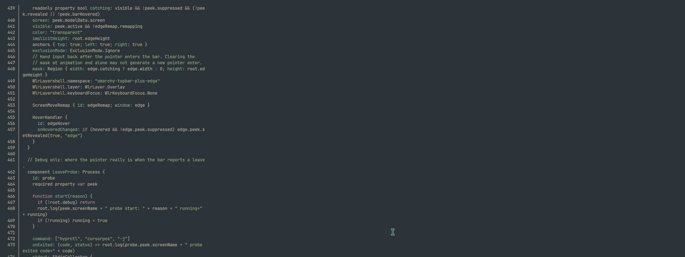
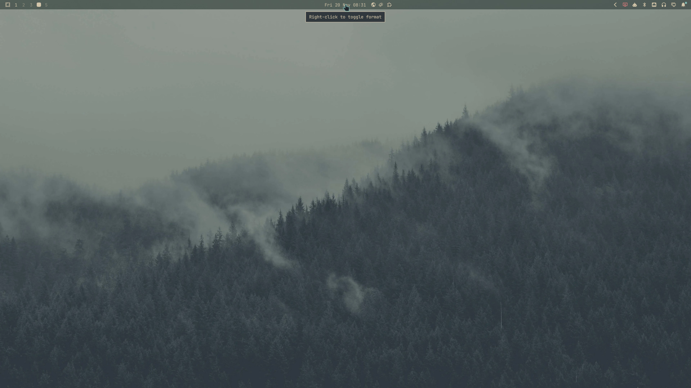

<div align="center">


# Omarchy Top Bar Plus

### La barra superior de Omarchy, fuera de tu vista hasta que la necesitas

[](CHANGELOG.es.md)
[](https://omarchy.org/)
[](https://hyprland.org/)
[](https://quickshell.org/)
[](LICENSE)

**[⬇️ Instalar](#instalación)** ·
**[📋 Novedades](CHANGELOG.es.md)** ·
**[⚙️ Cómo funciona](#cómo-funciona)** ·
**[🧪 Comprobar](#comprobar-o-desarrollar)**

[English](README.md) · **Español**

</div>

---

Oculta la barra con el atajo de siempre de Omarchy y recupera la pantalla entera.
Toca el borde superior de un monitor y su barra baja por encima de las ventanas;
aparta el ratón y vuelve a subir. Los widgets, el tema, los desplegables y la
bandeja se quedan tal cual los dibuja Omarchy, porque Top Bar Plus funciona dentro
del shell de Omarchy y hereda la barra que ya tienes.



## Qué hace

- 🖱️ **Asoma por monitor.** Cada pantalla tiene su propia franja de dos píxeles en
  el borde superior y solo muestra su barra.
- 🪟 **Encima de las ventanas, sin empujarlas.** La barra no reserva espacio al
  asomar, así que las ventanas en mosaico no se mueven, tampoco después de
  reconectar un monitor.
- 🧩 **Tu barra, sin tocar.** Los widgets, la distribución, los colores, las
  fuentes, el fondo, los menús, los desplegables y la bandeja son los nativos. No
  se copia nada.
- 🎬 **También a pantalla completa.** Asoma sobre una ventana con `Super + F` y
  usa la barra ahí mismo.
- 🙅 **Sitio para las apps con barra propia.** Pon a una ventana la etiqueta
  `no-bar-peek` y, mientras esté a pantalla completa o maximizada, el borde es
  solo suyo.
- 🎯 **Estable.** Sin parpadeos al entrar rápido, al dejar el ratón apoyado en el
  borde ni al cerrar un desplegable sobre la barra.
- ⏱️ **Se siente nativa.** Espera 120 ms después de que te vayas y sube en 140 ms
  con la misma curva que las tarjetas emergentes de Omarchy, y respeta
  `omarchy toggle animations`.
- 🪶 **Ligera.** Ni sondeos ni procesos en segundo plano: una consulta corta a
  `hyprctl` con los eventos de ventana y nada en reposo.
- 🔍 **Fácil de inspeccionar.** Una llamada de estado en JSON y un registro de
  depuración opcional.
- ✅ **Probada.** Pruebas unitarias de la lógica pura y una prueba real que mueve
  un ratón de verdad en cada monitor.

| Sobre ventanas en mosaico | Sobre una ventana a pantalla completa |
|---|---|
|  |  |



## Requisitos

| Componente | Versión |
|---|---|
| [Omarchy](https://omarchy.org/) | 4.5 |
| [Hyprland](https://hyprland.org/) | 0.56 o posterior |
| [Quickshell](https://quickshell.org/) | 0.3 |

Nada más para usarla. Top Bar Plus se apoya en detalles internos de la barra de
Omarchy 4.5, así que otras versiones de Omarchy pueden necesitar una
actualización del plugin. Solo funciona con la barra arriba.

## Instalación

```sh
omarchy plugin add https://github.com/Kuroge/omarchy-topbar-plus --enable --yes
```

Pulsa **Super + Shift + Espacio** para ocultar la barra, como siempre. Después
toca el borde superior de una pantalla para que asome. La barra se queda mientras
el ratón está encima y mientras tenga un desplegable abierto. Con la barra visible
todo funciona como siempre, y asomarla nunca cambia la preferencia guardada de
barra oculta.

Para actualizar, o para volver a la barra de serie:

```sh
omarchy plugin update io.github.kuroge.topbar-plus --yes
omarchy bar use omarchy.bar
omarchy plugin remove io.github.kuroge.topbar-plus --yes   # opcional, después de volver
```

## Apps con barra propia

Algunas apps a pantalla completa bajan su propia barra desde el borde superior,
como la barra de sesión del cliente de escritorio remoto RDPchy. Pon a sus
ventanas la etiqueta `no-bar-peek` con una regla de ventana de Hyprland, por
ejemplo en `~/.config/hypr/hyprland.lua`:

```lua
o.window("^com\\.freerdp\\.client\\.sdl3$", { tag = "+no-bar-peek" })
```

Mientras una ventana etiquetada está a pantalla completa o maximizada en el
espacio de trabajo activo de una pantalla, la barra de esa pantalla no asoma y su
franja del borde no recibe el ratón: el borde es de la app. Si la barra estaba
asomada, se oculta. Fuera de la pantalla completa, y con ventanas sin etiqueta, la
barra asoma como siempre.

## Qué ejecuta

Omarchy avisa de que los plugins son código sin aislar dentro del shell, así que
aquí tienes todo lo que hace Top Bar Plus fuera de su propio QML:

| Orden | Cuándo | Para qué |
|---|---|---|
| `hyprctl clients -j` | Con los eventos de ventana: pantalla completa, abrir, cerrar, mover, recargar la configuración | Encontrar las ventanas etiquetadas a pantalla completa |
| `hyprctl eval` con `hl.dsp.cursor.move` | Justo después de bajar la barra o de cerrarse un desplegable con el ratón quieto | Mover el puntero a su misma posición para que Hyprland note la barra debajo |
| `hyprctl cursorpos -j` | Solo con el registro de depuración activado, cuando el ratón sale de la barra | Registrar dónde está de verdad el puntero |

No usa la red, no escribe ficheros y no cambia ningún ajuste. Mientras asoma
cambia el margen superior, la capa y la zona de entrada de la barra nativa, y
mientras la barra está oculta su modo de exclusión; después lo devuelve todo como
estaba.

## Frente a Top Bar Peek

Top Bar Plus nació de [Top Bar Peek](https://github.com/WhiteHades/omarchy-topbar-peek),
escrito para Omarchy 4.0.4. En Omarchy 4.5:

| | Top Bar Peek | Top Bar Plus |
|---|---|---|
| Barra de Omarchy 4.5 | Choca con la posición nativa | Posición nativa en reposo; solo toma el control al asomar |
| En reposo | Capa transparente del tamaño de la pantalla sobre las ventanas | Nada sobre las ventanas |
| Sobre una ventana a pantalla completa | La barra no recibe el ratón | La barra funciona |
| Entrada rápida, ratón en el borde, cerrar un desplegable | Puede parpadear | Estable |
| Reconectar un monitor | Error, y ventanas empujadas hacia abajo | Resuelto |
| Apps con barra propia | — | Etiqueta `no-bar-peek` |
| Estado y registro de depuración | — | `status`, `setDebug` |
| Pruebas | Prueba real | Pruebas unitarias y prueba real con pruebas con nombre |

## Limitaciones conocidas

- La herencia de QML y la búsqueda de las barras nativas usan **detalles internos
  de la barra**, no una API estable de Omarchy. Una actualización de Omarchy puede
  necesitar una actualización del plugin.
- Solo con la barra arriba. Con la barra abajo o en un lateral, todo sigue como de
  serie.
- Hyprland no avisa cuando cambia una etiqueta. Una etiqueta puesta a mano a una
  ventana que ya está a pantalla completa se aplica con el siguiente evento de
  ventana: un cambio de pantalla completa, o abrir, cerrar o mover una ventana.
  Las etiquetas de una regla de ventana se aplican al abrirse la ventana.

## Cómo funciona

<details>
<summary>Los detalles, para curiosos</summary>

`Bar.qml` hereda de `qs.plugins.bar.Bar`. Busca las ventanas de la barra nativa y
añade en cada pantalla una franja Wayland de dos píxeles en la capa superior, más
un observador pasivo de hover en el elemento que contiene los widgets, para que
los manejadores nativos, incluido el cajón de la bandeja, sigan recibiendo el
ratón. Como la barra nativa, organiza sus piezas en componentes en línea:
`PeekController` por pantalla, `EdgeTrigger` para la franja y `LeaveProbe` para
el registro de depuración. La lógica pura está en `PeekModel.js`, que también
cargan las pruebas unitarias.

En Omarchy 4.5 cada barra nativa es una superficie transparente tan alta como su
pantalla, que al ocultarse se aparca una pantalla entera por encima. En reposo el
plugin no toca esa posición ni esa capa, así que nada de la barra queda sobre tus
ventanas. Al asomar toma el control del margen superior y de la capa: coloca la
barra justo por encima del borde, la sube a la capa superior y la hace bajar.
Cuando ha vuelto a subir, devuelve el margen y la capa a la barra nativa. Una
barra oculta no reserva espacio; la barra que se crea de nuevo al reconectar un
monitor, como un OLED que se desconecta del DisplayPort al despertar, puede
quedarse con el modo de exclusión normal, así que el plugin mantiene
`ExclusionMode.Ignore` mientras la barra está oculta.

Omarchy deja sin zona de entrada la barra mientras hay una ventana a pantalla
completa en su pantalla, para que la franja invisible no se quede los clics de
esa ventana. Al asomar sobre una ventana a pantalla completa, el plugin devuelve
la entrada a la franja visible y restaura la zona vacía nativa cuando la barra ha
subido.

Hyprland solo avisa a una superficie que se ha movido bajo un ratón quieto con el
siguiente movimiento del ratón. Hay dos casos en los que, si no, la barra subiría
y volvería a bajar enseguida: salir del borde antes de que termine de bajar, y
cerrar un desplegable cuya capa, del tamaño de la pantalla, se queda el ratón
mientras se desvanece. La barra se mantiene mientras baja y mientras se
desvanece un desplegable cerrado. Después, si la barra sigue sin ver el ratón, el
plugin mueve el puntero una vez a su misma posición para que Hyprland vuelva a
buscar la superficie que hay debajo.

Para encontrar las ventanas etiquetadas a pantalla completa, el plugin ejecuta
`hyprctl clients -j` con los eventos de ventana en vez de leer la lista de
ventanas de Quickshell. Esa lista nunca borra una ventana cuya respuesta de
actualización llega después de cerrarse, así que un cliente que sale de pantalla
completa justo antes de cerrarse podía quedarse ahí como a pantalla completa
hasta reiniciar el shell.

Cuando el ratón entra en la barra por debajo de la franja, la franja deja de
recibir el ratón. Los desplegables mantienen la barra hasta que se cierran, para
que puedas llegar a ellos sin perder su punto de anclaje.

</details>

## Estado y registro de depuración

```sh
omarchy shell topbar-plus status
omarchy shell topbar-plus setDebug true
journalctl --user --since "-5min" -o short-precise | grep topbar-plus
omarchy shell topbar-plus setDebug false
```

`status` muestra en JSON el estado de cada pantalla. El registro de depuración
viene apagado y se apaga solo al reiniciar el shell. Mientras está activado
registra cada vez que la barra asoma o se oculta y por qué, los cambios de
retención, cuándo toma y devuelve el margen y la capa, el estado de pantalla
completa y de exclusión de la barra nativa, los espacios de trabajo suprimidos,
dónde está de verdad el ratón cuando la barra dice que ha salido, y las pantallas
que se añaden o se quitan.

## Comprobar o desarrollar

```sh
omarchy plugin validate .
node --test tests/
python check.py
python check.py --only fullscreen,suppressed --repeat 3
python check.py --monitor DP-1
python check.py --reconnect DP-2
python check.py --appearance
```

`node --test tests/` ejecuta las pruebas unitarias de `PeekModel.js`: qué
ventanas impiden que la barra asome y dónde está el ratón. No necesitan sesión
gráfica y tardan milisegundos.

`check.py` es la prueba real. Ejecútala desde una sesión de Hyprland con Top Bar
Plus seleccionada y la barra arriba, y no toques el ratón mientras dura: se para
si el ratón se mueve. Necesita Python 3, `python-evdev`
(`omarchy pkg add python-evdev`), `foot` y permiso de escritura en `/dev/uinput`
para su ratón de prueba temporal, por ejemplo con
`sudo setfacl -m u:$USER:rw /dev/uinput`, que dura hasta el siguiente reinicio.
Lo comprueba todo antes de empezar y, si falta algo, se para y dice cómo
arreglarlo. Mover el puntero desde el compositor no basta para que una superficie
reciba movimiento, así que usa eventos de entrada reales.

<details>
<summary>Las pruebas, en el orden en que se ejecutan</summary>

`--only` acepta estos nombres.

| Prueba | En cada pantalla, con la barra oculta |
|---|---|
| `peek` | Asomar desde el borde, hover sobre los widgets, posición y escala en la capa superior, volver a entrar justo al ocultarse, bandeja, ocultar, posición nativa en reposo, ventanas y espacio reservado sin cambios |
| `fast-entry` | Salir del borde antes de que la barra termine de bajar no la oculta |
| `edge-rest` | Dejar el ratón apoyado en el borde no oculta la barra |
| `popout-rest` | Cerrar un desplegable sobre la barra no la hace parpadear |
| `fullscreen` | Sobre una ventana `foot` temporal a pantalla completa, la barra recibe el ratón al asomar y lo devuelve al ocultarse |
| `suppressed` | Sobre una ventana etiquetada a pantalla completa o maximizada, el borde ni hace asomar la barra ni recibe el ratón |
| `suppressed-peeking` | Si una ventana etiquetada pasa a pantalla completa con la barra asomada, la barra se oculta |
| `suppressed-close` | Salir de pantalla completa y cerrar seguida una ventana etiquetada, como hace un cliente de escritorio remoto, devuelve el borde, de acuerdo con Hyprland |
| `clock` | El desplegable del reloj mantiene la barra y la suelta al cerrarse |
| `pinned` | La barra visible de siempre se queda fija, y la bandeja funciona ahí |

Las pruebas de la bandeja se saltan si no hay elementos en el cajón. Al terminar,
la prueba cierra sus ventanas, devuelve el foco a tu ventana, cierra cualquier
desplegable y restaura el ratón y la preferencia de barra oculta; cada paso de la
limpieza se ejecuta aunque falle otro.

`--repeat` repite las pruebas elegidas varias veces, para cazar fallos que salen
de vez en cuando. `--monitor` prueba solo una salida, para comprobar monitores
con distinta escala. `--reconnect` apaga las pantallas 20 segundos, como haría el
gestor de inactividad, y prueba esa salida cuando se ha desconectado y ha vuelto;
falla si la salida no llega a desconectarse. Mantiene durante la reconexión una
ventana etiquetada a pantalla completa y después compara la supresión con
Hyprland. `--appearance` repite la prueba con cada fondo de barra (`opaque`,
`glassy`, `none`) con el fondo de escritorio activado y desactivado, y después
restaura los dos ajustes. Cambiar el fondo recarga Hyprland cuando se activa o
desactiva el desenfoque de `glassy`.

</details>

Si trabajas con una copia local, instálala y reinicia el shell, porque la recarga
en caliente de los plugins puede quedarse con QML en caché:

```sh
rsync -a --delete-excluded --include=manifest.json --include=Bar.qml --include=PeekModel.js \
  --include=LICENSE --exclude='*' ./ ~/.config/omarchy/plugins/io.github.kuroge.topbar-plus/
omarchy restart shell
```

## Créditos

- Autor: **Adrian Garcia Riera** ([Kuroge](https://github.com/Kuroge)).
- Basado en [Omarchy Top Bar Peek](https://github.com/WhiteHades/omarchy-topbar-peek),
  de **WhiteHades**, cuyo historial conserva este repositorio.
- [El plugin de ocultación automática de ericvrp](https://github.com/ericvrp/omarchy-bar-autohide),
  de **Eric van Riet Paap**, la referencia de la franja del borde y del observador
  de hover originales.
- [Omarchy](https://omarchy.org/), [Hyprland](https://hyprland.org/) y
  [Quickshell](https://quickshell.org/), que hacen el trabajo duro.

## Licencia

Publicado bajo la [licencia MIT](LICENSE), conservando los avisos de copyright de
los autores originales.
