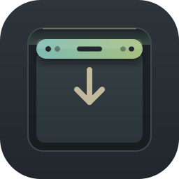
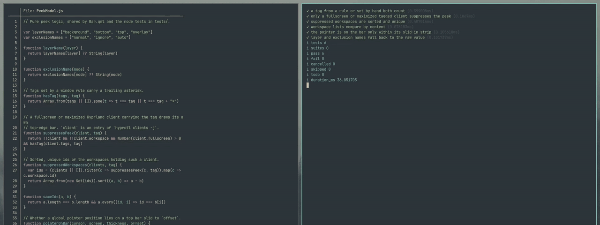

<div align="center">



# Omarchy Top Bar Plus

### La barra superior de Omarchy, oculta hasta que la necesitas

[](CHANGELOG.es.md)
[](https://omarchy.org/)
[](https://hyprland.org/)
[](https://quickshell.org/)
[](LICENSE)

**[⬇️ Instalar](#instalación)** ·
**[📋 Novedades](CHANGELOG.es.md)** ·
**[⚙️ Cómo funciona](#cómo-funciona)** ·
**[🧪 Pruebas](#pruebas-y-desarrollo)**

[English](README.md) · **Español**

</div>

---

Esconde la barra con el atajo de siempre y aprovecha toda la pantalla. Cuando te
haga falta, lleva el ratón al borde de arriba y aparecerá encima de las ventanas;
en cuanto te vayas, desaparece. Y no es una barra nueva: es la tuya, con tus
widgets, tu tema, tus menús y tu bandeja, porque Top Bar Plus funciona dentro del
propio shell de Omarchy.


## Por qué

Entre otros motivos, para cuidar al máximo las pantallas OLED. Pocas cosas le
sientan peor a un OLED que una barra fija: los mismos iconos y el mismo texto en
los mismos píxeles durante horas y horas terminan dejando marca, lo que se conoce
como quemado de pantalla o *burn-in*.

Omarchy ya te deja ocultar la barra, pero entonces la pierdes justo cuando la
necesitas. Con Top Bar Plus la tienes a mano en todo momento: tocas el borde y ahí
está. Puedes dejarla oculta para siempre sin echarla de menos, y esa franja de la
pantalla pasa a mostrar tus ventanas o el fondo, como el resto.

## Qué hace

- 🛡️ **Amiga de los OLED.** Nada de una barra fija marcándose en la parte de
  arriba del panel: solo está a la vista mientras la usas.
- 🖱️ **Un borde por monitor.** Cada pantalla tiene su propia franja de dos
  píxeles arriba del todo y solo saca su barra.
- 🪟 **Encima de las ventanas, sin empujarlas.** No reserva espacio, así que las
  ventanas en mosaico no se mueven ni un píxel, tampoco después de reconectar un
  monitor.
- 🧩 **Es tu barra.** Widgets, colores, fuentes, menús, desplegables y bandeja son
  los de Omarchy; el plugin no copia nada.
- 🎬 **También con pantalla completa.** Funciona encima de una ventana a pantalla
  completa (`Super + F`) y puedes usar la barra sin salir de ella.
- 🙅 **Deja sitio a las apps con barra propia.** Con la etiqueta `no-bar-peek`,
  el borde es de la app mientras esté a pantalla completa o maximizada.
- 🎯 **Sin parpadeos.** Ni al entrar deprisa, ni con el ratón apoyado en el
  borde, ni al cerrar un desplegable.
- ⏱️ **Se mueve como Omarchy.** Espera 120 ms antes de irse y se esconde en 140 ms
  con la misma animación que los paneles emergentes de Omarchy. Si desactivas las
  animaciones (`omarchy toggle animations`), también se da por enterada.
- 🪶 **No gasta nada en reposo.** Sin procesos en segundo plano ni comprobaciones
  cada pocos segundos: solo una consulta rápida a `hyprctl` cuando cambian las
  ventanas.
- 🔍 **Sin secretos.** Puedes ver su estado en JSON y activar un registro
  detallado cuando quieras.
- ✅ **Bien probada.** Tiene pruebas unitarias y una prueba real que maneja un
  ratón de verdad en cada monitor.

| Con ventanas en mosaico | Con una ventana a pantalla completa |
|---|---|
|  |  |


## Requisitos

| Componente | Versión |
|---|---|
| [Omarchy](https://omarchy.org/) | 4.5 |
| [Hyprland](https://hyprland.org/) | 0.56 o posterior |
| [Quickshell](https://quickshell.org/) | 0.3 |

No hace falta nada más. Eso sí: Top Bar Plus tira de detalles internos de la barra
de Omarchy 4.5, así que en otras versiones puede necesitar una actualización. Y,
de momento, solo funciona con la barra arriba.

## Instalación

```sh
omarchy plugin add https://github.com/Kuroge/omarchy-topbar-plus --enable --yes
```

Esconde la barra con **Super + Shift + Espacio**, como de costumbre, y acerca el
ratón al borde superior de cualquier pantalla. La barra se queda mientras tengas
el ratón encima o algún desplegable abierto. Si prefieres tenerla siempre a la
vista, se comporta igual que siempre, y el que aparezca al pasar el ratón no
cambia tu preferencia.

Para actualizarla o volver a la barra original:

```sh
omarchy plugin update io.github.kuroge.topbar-plus --yes
omarchy bar use omarchy.bar
omarchy plugin remove io.github.kuroge.topbar-plus --yes   # opcional, después de volver a la barra original
```

## Apps con barra propia

Hay apps que, a pantalla completa, sacan su propia barra desde el borde de arriba.
Es el caso de RDPchy, un cliente de escritorio remoto para Omarchy, con su barra
de sesión. RDPchy ya viene preparado: marca sus ventanas de sesión por su cuenta y
no tienes que tocar nada. Si lo buscas y no lo encuentras, es normal: todavía es
privado.

Con cualquier otra app basta con ponerle a sus ventanas la etiqueta `no-bar-peek`
mediante una regla de Hyprland, por ejemplo en `~/.config/hypr/hyprland.lua`. La
`class` de la ventana te la da `hyprctl clients`:

```lua
o.window("^org\\.example\\.App$", { tag = "+no-bar-peek" })
```

A partir de ahí, mientras esa ventana esté a pantalla completa o maximizada en el
espacio de trabajo que tengas delante, la barra de esa pantalla no aparece y su
franja ni se entera del ratón: el borde es todo de la app. Si en ese momento la
barra estaba a la vista, se esconde. En cuanto la ventana sale de pantalla
completa, o con ventanas sin la etiqueta, todo vuelve a funcionar como siempre.

## Qué ejecuta

Al instalar un plugin, Omarchy te avisa de que se ejecuta sin aislamiento dentro
del shell. Para que sepas a qué atenerte, esto es todo lo que hace Top Bar Plus
fuera de su propio código QML:

| Orden | Cuándo | Para qué |
|---|---|---|
| `hyprctl clients -j` | Cuando cambian las ventanas: pantalla completa, abrir, cerrar, mover o recargar la configuración | Saber qué ventanas con la etiqueta están a pantalla completa |
| `hyprctl eval` con `hl.dsp.cursor.move` | Al terminar de bajar la barra, o al cerrar un desplegable, si el ratón está quieto | Dejar el puntero en su mismo sitio para que Hyprland se dé cuenta de que la barra está debajo |
| `hyprctl cursorpos -j` | Solo con el registro activado, cuando el ratón sale de la barra | Anotar dónde está de verdad el puntero |

Ni se conecta a internet, ni escribe ficheros, ni toca tu configuración. Mientras
la barra está a la vista ajusta su margen superior, su capa y la zona que recibe
el ratón, y mientras está oculta, su modo de exclusión. Al terminar, todo queda
como estaba.

## Diferencias con Top Bar Peek

Top Bar Plus nació a partir de [Top Bar Peek](https://github.com/WhiteHades/omarchy-topbar-peek),
pensado para Omarchy 4.0.4. Así se comparan en Omarchy 4.5:

| | Top Bar Peek | Top Bar Plus |
|---|---|---|
| Integración con la barra de 4.5 | Se pelea con la posición nativa | Respeta la posición nativa y solo la toma mientras la barra está a la vista |
| En reposo | Deja una capa transparente del tamaño de la pantalla encima de las ventanas | No deja nada encima |
| Con una ventana a pantalla completa | La barra no responde al ratón | La barra funciona con normalidad |
| Entrar deprisa, apoyar el ratón en el borde, cerrar un desplegable | Puede parpadear | Sin parpadeos |
| Al reconectar un monitor | Da error y empuja las ventanas hacia abajo | Ningún problema |
| Apps con barra propia | — | Etiqueta `no-bar-peek` |
| Estado y registro | — | `status` y `setDebug` |
| Pruebas | Prueba real | Pruebas unitarias y prueba real por partes |

## Limitaciones conocidas

- Para heredar la barra y encontrar sus ventanas, el plugin usa **detalles
  internos de la barra de Omarchy**, no una API estable. Alguna actualización de
  Omarchy puede obligar a actualizar también el plugin.
- De momento solo funciona con la barra arriba. Con la barra abajo o en un
  lateral, todo sigue como de fábrica.
- Hyprland no avisa cuando cambia una etiqueta. Si se la pones a mano a una
  ventana que ya está a pantalla completa, el plugin no se entera hasta el
  siguiente cambio de ventanas: entrar o salir de pantalla completa, o abrir,
  cerrar o mover una ventana. Con una regla no pasa, porque la etiqueta está
  puesta desde que se abre la ventana.

## Cómo funciona

<details>
<summary>Para curiosos</summary>

`Bar.qml` hereda de `qs.plugins.bar.Bar`. Busca las ventanas de la barra nativa y,
en cada pantalla, añade dos cosas: una franja Wayland de dos píxeles en la capa
superior y un observador pasivo del ratón en el contenedor de los widgets. Como el
observador no intercepta nada, los widgets nativos, incluido el cajón de la
bandeja, siguen recibiendo el ratón igual que siempre. El código está organizado
como la barra nativa, con componentes en línea: `PeekController` para cada
pantalla, `EdgeTrigger` para la franja y `LeaveProbe` para el registro. La lógica
que no depende de la interfaz vive en `PeekModel.js`, que es lo que comprueban las
pruebas unitarias.

En Omarchy 4.5, cada barra nativa es una superficie transparente tan alta como la
pantalla que, cuando está oculta, se aparca justo encima, fuera de la vista. En
reposo el plugin la deja tal cual, así que no queda nada suyo encima de las
ventanas. Cuando la barra tiene que aparecer, el plugin toma el control del margen
superior y de la capa: la sitúa justo por encima del borde, la sube a la capa
superior y la desliza hacia abajo. Al esconderse, le devuelve el control a la
barra nativa. Una barra oculta no debería reservar espacio, pero la que se crea al
reconectar un monitor (por ejemplo, un OLED que se desconecta del DisplayPort al
despertar) puede quedarse con el modo de exclusión normal; por eso el plugin
fuerza `ExclusionMode.Ignore` mientras la barra está oculta.

Cuando hay una ventana a pantalla completa, Omarchy desactiva la entrada de la
barra para que su franja invisible no le robe clics a la ventana. Si la barra
aparece por encima, el plugin le devuelve la entrada a la parte visible, y al
esconderse la deja otra vez como la tenía Omarchy.

Hyprland no avisa a una superficie que se ha colocado bajo el ratón hasta que el
ratón se mueve. Eso provocaba dos rebotes: al irte del borde antes de que la barra
terminara de bajar, y al cerrar un desplegable, cuya capa ocupa toda la pantalla y
se queda con el ratón mientras se desvanece. La solución es mantener la barra
mientras baja y mientras se desvanece el desplegable. Si después sigue sin
enterarse de que tiene el ratón encima, el plugin deja el puntero en su mismo
sitio, una sola vez, para que Hyprland vuelva a mirar qué hay debajo.

Para saber qué ventanas con la etiqueta están a pantalla completa, el plugin
pregunta a `hyprctl clients -j` cuando cambian las ventanas, en lugar de fiarse de
la lista de Quickshell. Esa lista nunca borra una ventana si la respuesta a una
actualización llega después de cerrarla, así que un programa que sale de pantalla
completa justo antes de cerrarse podía quedarse ahí, como si siguiera a pantalla
completa, hasta reiniciar el shell.

Cuando el ratón entra en la barra por debajo de la franja, la franja deja de
recogerlo. Y mientras haya un desplegable abierto la barra no se mueve, para que
puedas llegar hasta él sin que se te escape.

</details>

## Estado y registro de depuración

```sh
omarchy shell topbar-plus status
omarchy shell topbar-plus setDebug true
journalctl --user --since "-5min" -o short-precise | grep topbar-plus
omarchy shell topbar-plus setDebug false
```

`status` te da en JSON el estado de cada pantalla. El registro está desactivado
por defecto y se vuelve a desactivar solo al reiniciar el shell. Mientras está
activo anota cuándo aparece o se esconde la barra y por qué, cuándo se queda
retenida, cuándo toma y devuelve el margen y la capa, el estado de pantalla
completa y de exclusión de la barra nativa, los espacios de trabajo donde no debe
aparecer, dónde está de verdad el ratón cuando la barra cree que se ha ido y qué
pantallas se conectan o desconectan.

## Pruebas y desarrollo

```sh
omarchy plugin validate .
node --test tests/
python check.py
python check.py --only fullscreen,suppressed --repeat 3
python check.py --monitor DP-1
python check.py --reconnect DP-2
python check.py --appearance
```

`node --test tests/` lanza las pruebas unitarias de `PeekModel.js`, que comprueban
qué ventanas impiden que aparezca la barra y dónde está el ratón. No necesitan
sesión gráfica y van en milisegundos.

`check.py` es la prueba de verdad. Lánzala desde una sesión de Hyprland con Top
Bar Plus como barra y la barra arriba, y no toques el ratón mientras dura, porque
si se mueve la prueba se para. Necesita Python 3, `python-evdev`
(`omarchy pkg add python-evdev`), `foot` y permiso de escritura en `/dev/uinput`
para crear su ratón de pruebas; te vale con `sudo setfacl -m u:$USER:rw /dev/uinput`,
que dura hasta que reinicies. Antes de empezar revisa que no falte nada y, si
falta algo, te dice cómo solucionarlo. Usa eventos de ratón reales porque mover el
puntero desde el compositor no basta para que una superficie note el movimiento.

<details>
<summary>Las pruebas, en el orden en que se lanzan</summary>

Estos son los nombres que acepta `--only`.

| Prueba | En cada pantalla, con la barra oculta |
|---|---|
| `peek` | La barra aparece desde el borde, responde al pasar por los widgets, se coloca bien y a la escala correcta en la capa superior, aguanta si vuelves justo cuando se iba, la bandeja funciona, se esconde, vuelve a su posición nativa y ni las ventanas ni el espacio reservado cambian |
| `fast-entry` | Irse del borde antes de que la barra termine de bajar no la esconde |
| `edge-rest` | Dejar el ratón apoyado en el borde no la esconde |
| `popout-rest` | Cerrar un desplegable encima de la barra no la hace parpadear |
| `fullscreen` | Sobre una ventana `foot` temporal a pantalla completa, la barra responde al ratón y, al esconderse, devuelve la entrada |
| `suppressed` | Sobre una ventana con la etiqueta a pantalla completa o maximizada, el borde ni saca la barra ni se queda con el ratón |
| `suppressed-peeking` | Si una ventana con la etiqueta pasa a pantalla completa con la barra a la vista, la barra se esconde |
| `suppressed-close` | Salir de pantalla completa y cerrar enseguida una ventana con la etiqueta, como hace un cliente de escritorio remoto, devuelve el borde, y el plugin coincide con lo que dice Hyprland |
| `clock` | El desplegable del reloj mantiene la barra a la vista y la suelta al cerrarse |
| `pinned` | Con la barra siempre visible, se queda fija y la bandeja funciona |

Si el cajón de la bandeja está vacío, sus pruebas se saltan. Al acabar, la prueba
cierra sus ventanas, te devuelve el foco, cierra cualquier desplegable y deja el
ratón y la preferencia de barra oculta como estaban; cada paso de la limpieza se
hace aunque falle otro.

`--repeat` repite las pruebas elegidas varias veces, para pillar fallos que solo
salen de vez en cuando. `--monitor` prueba una sola salida, algo útil con
monitores de distinta escala. `--reconnect` apaga las pantallas 20 segundos, como
haría el gestor de inactividad, y prueba esa salida cuando se ha desconectado y ha
vuelto; si no llega a desconectarse, falla. Durante la reconexión mantiene abierta
una ventana con la etiqueta a pantalla completa y, al final, comprueba que el
plugin coincide con Hyprland. `--appearance` repite la prueba con cada fondo de
barra (`opaque`, `glassy` y `none`), con el fondo de escritorio activado y
desactivado, y después deja los dos ajustes como estaban. Al cambiar el fondo,
Hyprland se recarga si se activa o se desactiva el desenfoque de `glassy`.

</details>

Si trabajas con una copia local, cópiala a la carpeta de plugins y reinicia el
shell; la recarga en caliente a veces se queda con QML antiguo en caché:

```sh
rsync -a --delete-excluded --include=manifest.json --include=Bar.qml --include=PeekModel.js \
  --include=LICENSE --exclude='*' ./ ~/.config/omarchy/plugins/io.github.kuroge.topbar-plus/
omarchy restart shell
```

## Créditos

- Autor: **Adrian Garcia Riera** ([Kuroge](https://github.com/Kuroge)).
- Parte de [Omarchy Top Bar Peek](https://github.com/WhiteHades/omarchy-topbar-peek),
  de **WhiteHades**; este repositorio conserva su historial.
- La franja del borde y el observador del ratón originales se inspiraron en
  [el plugin de ocultación automática de ericvrp](https://github.com/ericvrp/omarchy-bar-autohide),
  de **Eric van Riet Paap**.
- Y, por supuesto, [Omarchy](https://omarchy.org/), [Hyprland](https://hyprland.org/)
  y [Quickshell](https://quickshell.org/), que hacen el trabajo duro.

## Licencia

Se distribuye con [licencia MIT](LICENSE) y conserva los avisos de copyright de
los autores originales.
