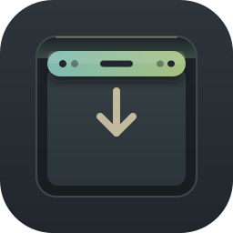
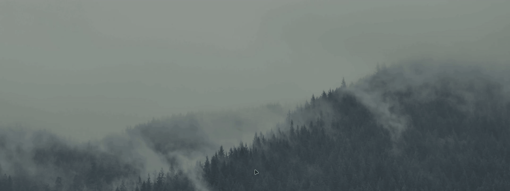
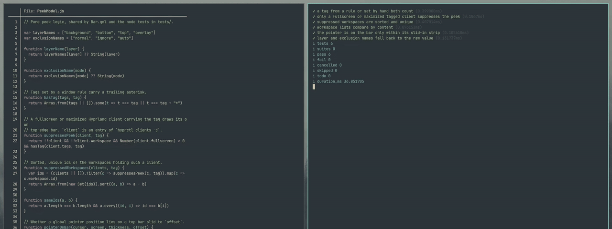
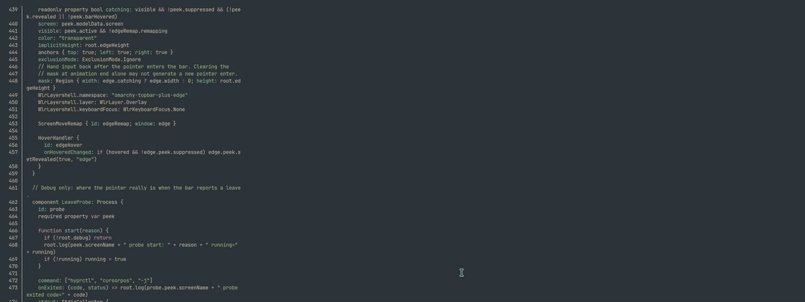
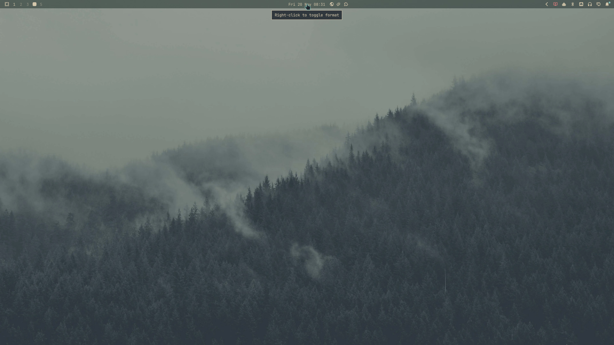

<div align="center">



# Omarchy Top Bar Plus

### Your Omarchy top bar, out of the way until you reach for it

[](CHANGELOG.md)
[](https://omarchy.org/)
[](https://hyprland.org/)
[](https://quickshell.org/)
[](LICENSE)
[](https://omarchyplugins.com/plugin.html?id=io.github.kuroge.topbar-plus)

**[⬇️ Install](#install)** ·
**[📋 What's new](CHANGELOG.md)** ·
**[⚙️ How it works](#how-it-works)** ·
**[🧪 Verify](#verify-or-develop)**

**English** · [Español](README.es.md)

</div>

---

Hide the bar with the usual Omarchy toggle and get the whole screen back. Touch
the top edge of a monitor and that monitor's bar slides in over your windows;
move away and it slides out. Your widgets, theme, popouts and tray stay exactly
as Omarchy draws them, because Top Bar Plus runs inside the Omarchy shell and
inherits the bar you already have.



## Why

Among other things, to spare OLED screens as much as possible. A bar that
never moves is exactly what an OLED panel handles worst: the same icons and
text on the same pixels, hour after hour, can leave a permanent mark, known as
burn-in. Omarchy can already hide the bar, but then it is gone when you need
it. Top Bar Plus brings it back the moment you reach the top edge, so you can
keep it hidden for good: it is only on screen while you use it, and the rest
of the time that strip shows your windows and wallpaper like the rest of the
screen.

## Features

- 🛡️ **Kinder to OLED screens.** No static bar burning into the top of the
  panel; it only shows up while you use it.
- 🖱️ **Peek per monitor.** Each screen has its own two-pixel trigger along the
  top edge and reveals only its own bar.
- 🪟 **Over your windows, never pushing them.** A peeking bar reserves no
  space, so tiled windows stay put, also after a monitor reconnects.
- 🧩 **Your bar, untouched.** Widgets, layout, colours, fonts, background,
  menus, popouts and the tray drawer are the native ones. Nothing is copied.
- 🎬 **Fullscreen too.** Peek over a `Super + F` window and use the bar there.
- 🙅 **Room for apps with their own top bar.** Tag a window `no-bar-peek` and,
  while it is fullscreen or maximized, the edge is all its own.
- 🎯 **Steady.** No flicker on a fast entry, when resting against the edge or
  after closing a popout over the bar.
- ⏱️ **Native feel.** It waits 120 ms after you leave and slides out in 140 ms
  with the easing of Omarchy's popup cards, following
  `omarchy toggle animations`.
- 🪶 **Light.** No polling and no daemon: one short `hyprctl` query on window
  events, nothing at rest.
- 🔍 **Easy to inspect.** A JSON status call and opt-in debug logging.
- ✅ **Tested.** Unit tests for the pure logic, and a live check that drives a
  real pointer on every monitor.

| Over tiled windows | Over a fullscreen window |
|---|---|
|  |  |



## Requirements

| Component | Version |
|---|---|
| [Omarchy](https://omarchy.org/) | 4.5 |
| [Hyprland](https://hyprland.org/) | 0.56 or newer |
| [Quickshell](https://quickshell.org/) | 0.3 |

Nothing else at runtime. Top Bar Plus builds on internal details of Omarchy
4.5's bar, so other Omarchy versions may need an update of the plugin. For now,
it only works with the bar at the top.

## Install

```sh
omarchy plugin add https://github.com/Kuroge/omarchy-topbar-plus --enable --yes
```

Press **Super + Shift + Space** to hide the bar, as usual. Then touch the top
edge of a screen to peek. The bar stays while the pointer is over it and while
one of its popouts is open. A normally visible bar behaves as usual, and
hovering never changes the saved hidden preference.

Update, or go back to the stock bar:

```sh
omarchy plugin update io.github.kuroge.topbar-plus --yes
omarchy bar use omarchy.bar
omarchy plugin remove io.github.kuroge.topbar-plus --yes   # optional, after switching back
```

## Apps with their own top bar

Some fullscreen apps slide down their own bar from the top edge, such as the
session bar of RDPchy, a remote desktop client for Omarchy. RDPchy already
tags its session windows this way out of the box, so there is nothing to do
for it. RDPchy is still private, so you will not find it on GitHub yet.

For any other app, give its windows the `no-bar-peek` tag with a Hyprland
window rule, for example in `~/.config/hypr/hyprland.lua`. `hyprctl clients`
shows the `class` to match:

```lua
o.window("^org\\.example\\.App$", { tag = "+no-bar-peek" })
```

While a tagged window is fullscreen or maximized on a screen's active
workspace, that screen's bar does not peek and its edge trigger takes no
pointer input, so the edge belongs to the app. A peeking bar slides out when
that happens. Out of fullscreen, and for untagged fullscreen windows, the bar
peeks as usual.

## What it runs

Omarchy warns that plugins run as unsandboxed code inside the shell, so here
is everything Top Bar Plus does outside its own QML:

| Command | When | Why |
|---|---|---|
| `hyprctl clients -j` | On window events: fullscreen, open, close, move, config reload | Find tagged fullscreen windows |
| `hyprctl eval` with `hl.dsp.cursor.move` | Right after a slide-in or a popout closes under a resting pointer | Warp the pointer onto its own position, so Hyprland notices the bar under it |
| `hyprctl cursorpos -j` | Only with debug logging on, when the pointer leaves the bar | Log where the pointer really is |

It uses no network, writes no files and changes no settings. While peeking it
sets the native bar's top margin, layer and input region, and while the bar is
hidden its exclusion mode; it hands all of them back afterwards.

## Compared with Top Bar Peek

Top Bar Plus started from [Top Bar Peek](https://github.com/WhiteHades/omarchy-topbar-peek),
written for Omarchy 4.0.4. On Omarchy 4.5:

| | Top Bar Peek | Top Bar Plus |
|---|---|---|
| Omarchy 4.5 bar | Competes with the native placement | Native placement at rest, takes over only while peeking |
| At rest | Transparent full-screen layer above the windows | Nothing above the windows |
| Over a fullscreen window | Bar takes no input | Bar works |
| Fast entry, edge rest, closing a popout | Can flicker | Steady |
| Monitor reconnect | Error, and windows pushed down | Handled |
| Apps with their own top bar | — | `no-bar-peek` tag |
| Status and debug log | — | `status`, `setDebug` |
| Tests | Live check | Unit tests and a live check with named checks |

## Known limitations

- The QML inheritance and panel discovery use **internal bar implementation
  details**, not a promised stable Omarchy API. Omarchy updates may require a
  plugin update.
- Top bars only, for now. With the bar at the bottom or on a side, the stock
  behaviour stays.
- Hyprland sends no event when a tag changes. A tag added by hand to a window
  that is already fullscreen takes effect at the next window event: a
  fullscreen change, or a window opening, closing or moving. Tags set by a
  window rule apply when the window opens.

## How it works

<details>
<summary>The details, for the curious</summary>

`Bar.qml` inherits `qs.plugins.bar.Bar`. It finds that bar's native panel
windows and adds, per screen, a two-pixel Wayland edge trigger on the overlay
layer plus a passive hover observer on the widgets' shared parent, so native
hover handlers, including the tray drawer, keep receiving pointer events. Like
the native bar, it keeps its parts as inline components: `PeekController` per
panel, `EdgeTrigger` for the strip and `LeaveProbe` for debug logging. Its pure
logic lives in `PeekModel.js`, which the unit tests load as well.

In Omarchy 4.5 each native panel is a transparent surface as tall as its screen
that parks a full screen height above it while hidden. At rest the plugin leaves
that placement and layer untouched, so nothing of the bar stays above your
windows. On reveal it takes over the panel's top margin and layer: it moves the
bar to one bar thickness above the edge, promotes it to the overlay layer and
slides it in. When the bar has slid out, it hands margin and layer back to the
native bar. A hidden bar reserves no space; a panel recreated for a monitor that
reconnects, such as an OLED that drops off DisplayPort when it wakes up, can keep
the normal exclusion mode, so the plugin holds `ExclusionMode.Ignore` while the
bar is hidden.

Omarchy clears the bar's input region while a fullscreen window is on its
screen, so the invisible strip cannot take that window's clicks. While peeking
over a fullscreen window, the plugin gives the visible strip its input back and
restores the native empty region once the bar has slid out.

Hyprland tells a surface that moved under a resting pointer only on the next
pointer motion. Two cases would otherwise make the bar slide out and straight
back in: leaving the edge before the slide-in ends, and closing a popout whose
full-screen layer keeps the pointer while it fades out. The bar is held while
sliding in and while a closed popout fades. Afterwards, if the bar still has not
seen the pointer, the plugin warps the pointer onto its own position once, so
Hyprland picks the surface under it again.

To find tagged fullscreen windows the plugin runs `hyprctl clients -j` on window
events instead of reading Quickshell's window list. That list never drops a
window whose refresh answer arrives after it closed, so a client that leaves
fullscreen right before closing could linger there as fullscreen until the shell
restarts.

Once the pointer enters the bar below the trigger, the trigger releases input.
Popouts hold the bar until dismissed, so you can move into them without losing
their anchor.

</details>

## Status and debug logging

```sh
omarchy shell topbar-plus status
omarchy shell topbar-plus setDebug true
journalctl --user --since "-5min" -o short-precise | grep topbar-plus
omarchy shell topbar-plus setDebug false
```

`status` prints the per-screen state as JSON. Debug logging is off by default
and resets when the shell restarts. While on, it logs reveals and hides with
their cause, hold changes, margin and layer hand-overs, the native panel's
fullscreen and exclusion state, the suppressed workspaces, where the pointer
really is when the bar reports a leave, and screens being added or removed.

## Verify or develop

```sh
omarchy plugin validate .
node --test tests/
python check.py
python check.py --only fullscreen,suppressed --repeat 3
python check.py --monitor DP-1
python check.py --reconnect DP-2
python check.py --appearance
```

`node --test tests/` runs the unit tests of `PeekModel.js`: which windows
suppress the peek and where the pointer lies. They need no session and finish in
milliseconds.

`check.py` is the live check. Run it from a Hyprland session with Top Bar Plus
selected and the bar at the top, and leave the pointer idle while it runs: it
stops if the pointer moves. It needs Python 3, `python-evdev`
(`omarchy pkg add python-evdev`), `foot` and write access to `/dev/uinput` for
its temporary test pointer, for example with
`sudo setfacl -m u:$USER:rw /dev/uinput`, which lasts until the next reboot. It
checks all of this first and stops with the fix for whatever is missing.
Compositor pointer warps alone do not deliver motion within a surface, so it
uses real input events.

<details>
<summary>The checks, in running order</summary>

`--only` takes these names.

| Check | On each screen, with the bar hidden |
|---|---|
| `peek` | Edge reveal, widget hover, overlay placement and scale, re-entry near the hide timeout, tray, hide, native park, unchanged window geometry and reserved space |
| `fast-entry` | Leaving the edge before the slide-in ends keeps the bar |
| `edge-rest` | Resting against the top edge keeps the bar |
| `popout-rest` | Closing a popout over the bar keeps it steady |
| `fullscreen` | Over a temporary fullscreen `foot` window the peeking bar takes input and hands it back |
| `suppressed` | Over a tagged fullscreen or maximized window the edge neither reveals the bar nor takes the pointer |
| `suppressed-peeking` | A tagged window going fullscreen slides a peeking bar out |
| `suppressed-close` | Leaving fullscreen and closing a tagged window straight away, as a remote desktop client does, gives the edge back, in step with Hyprland |
| `clock` | The clock popup holds the bar open and releases it on close |
| `pinned` | The normally visible bar stays pinned, and the tray works there |

Tray checks report a skip when there are no drawer items. Afterwards the check
closes its windows, refocuses your window, closes any popout and restores the
pointer and the hidden preference; each cleanup step runs even if another
fails.

`--repeat` runs the selected checks several times, to catch intermittent
failures. `--monitor` checks a single output, for mixed-DPI testing.
`--reconnect` turns the outputs off for 20 seconds, as an idle daemon would,
then checks that output once it has disconnected and come back; it fails if the
output never disconnects. It keeps a tagged fullscreen window open across the
reconnect and compares the suppression with Hyprland afterwards.
`--appearance` repeats the check with every bar background (`opaque`,
`glassy`, `none`) with the desktop wallpaper enabled and disabled, then
restores both settings. Changing the background reloads Hyprland when the
glassy blur toggles.

</details>

When working on a local copy, install it and restart the shell, because plugin
hot-reload can retain cached QML:

```sh
rsync -a --delete-excluded --include=manifest.json --include=Bar.qml --include=PeekModel.js \
  --include=LICENSE --exclude='*' ./ ~/.config/omarchy/plugins/io.github.kuroge.topbar-plus/
omarchy restart shell
```

## Credits

- Author: **Adrian Garcia Riera** ([Kuroge](https://github.com/Kuroge)).
- Based on [Omarchy Top Bar Peek](https://github.com/WhiteHades/omarchy-topbar-peek)
  by **WhiteHades**, whose history this repository keeps.
- [ericvrp's autohide plugin](https://github.com/ericvrp/omarchy-bar-autohide),
  by **Eric van Riet Paap**, the reference for the original edge trigger and
  hover observer.
- [Omarchy](https://omarchy.org/), [Hyprland](https://hyprland.org/) and
  [Quickshell](https://quickshell.org/), which do the heavy lifting.

## License

Released under the [MIT License](LICENSE), keeping the copyright notices of the
original authors.
